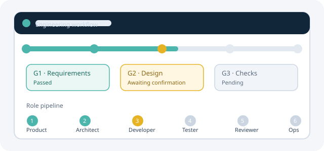

把 `engineering-craft` 的方法论搬进 DeepSeek Harness：阶段门、交接物、工程记忆与严格的六岗位 subagent 流水线，都变成会话里可查、可看、可拍板的东西。

## 能做什么

- **阶段门可视化**：面板实时显示当前阶段与 G1/G2/G3 三门状态、缺失的交接物。门不是提示，是工具会拒绝下游动作的状态。
- **交接物落盘**：PRD / ADR / CONTRACT / PLAN / Brief / Release 模板生成与结构校验，跨会话可续。
- **工程记忆**：`ec_memory` 工具维护项目级 `.project_memory/`，只写规范、带来源与日期，不遗忘。
- **六岗位流水线**：产品 → 架构 → 研发 → 测试 → 评审 → 运维，顺序严格。下游在上游交接物落盘前不启动，交接只传路径指针，主 agent 集成重验。专为 DSH 的 subagent 机制优化，不做单 agent 退化。
- **人保留拍板权**：G1/G2 确认与发布 go/no-go 通过确认卡请求用户决定，agent 不替你拍板。

## 怎么用

安装完成后，`/ec status` 查看当前门与岗位；`/ec next` 查下一岗位是否可启动。会话头的「工程面板」按钮打开完整面板。

## 说明

- 门是"状态可见 + 工具纪律"，不是内核级强制；agent 仍需遵守工具返回。
- 不重实现 DSH 已有的 tools / subagent / slots，只做编排。
- 需要 DSH 0.2.2-rc.1+。
